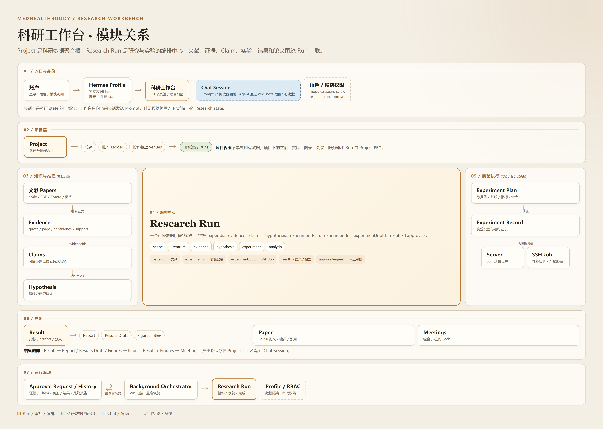
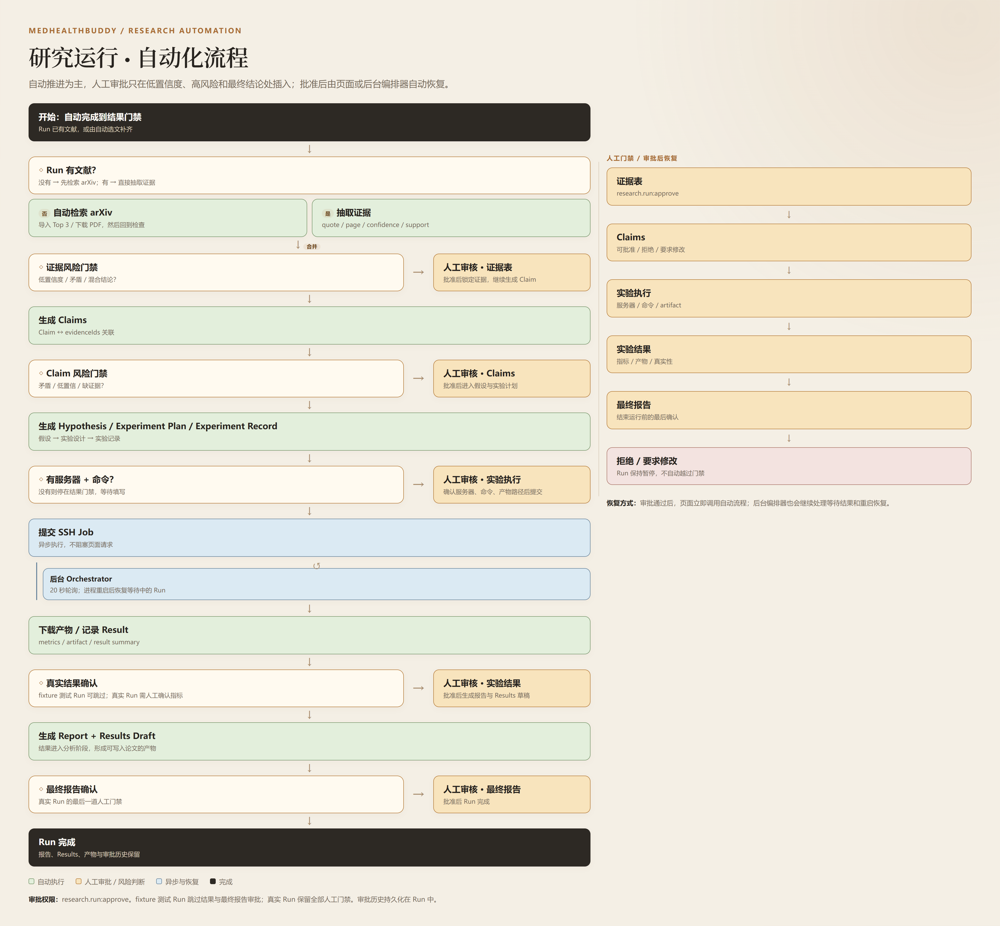

# 科研工作台模块关系与自动化流程

本文配套两张 2x 渲染图，适合直接放入汇报、方案或设计评审：

```text
docs/architecture/research-workbench-modules.png
docs/architecture/research-automation-flow.png
```

## 1. 科研工作台模块关系



### 核心关系

```text
Project
└── Research Run
    ├── paperIds          → 文献 Papers
    ├── evidence[]        → 原文引用 / 页码 / 置信度
    ├── claims[]          → Claim 与证据关系
    ├── hypothesis        → 待验证假设
    ├── experimentPlan    → 数据集 / 基线 / 指标 / 命令
    ├── experimentId      → Experiment Record
    ├── experimentJobId   → SSH Job
    ├── result            → Result / 指标 / 产物
    ├── approvals[]       → 已通过审批
    └── approvalRequest   → 当前待审批请求
```

`Project` 是科研数据的聚合根；`Research Run` 不是 Project 的替代，而是把文献、证据、Claim、假设、实验、结果和产出串起来的编排记录。

### 页签与实体

| 工作台页签 | 对应实体 / 作用 |
|---|---|
| 总览 | Project 聚合视图 |
| 论文 | Paper / LaTeX 编辑、编译、引用 |
| 文献 | Papers、Evidence 来源 |
| 研究运行 | Research Run 状态机 |
| 实验 | Experiment Record、Job |
| 图表 | Figures |
| 会议 | Meetings / Deck |
| 服务器 | Server / SSH 连接 |
| 账本 | Ledger / 研究过程记录 |
| 投稿截止 | Venues |

### 会话与工作台

```text
Chat Session
├── 对话、工具调用、附件
└── 不是科研 state 的一部分

科研工作台
├── Project / Papers / Experiments / Runs
└── 通过 Prompt 当前会话发送请求
```

- 工作台向当前 Chat Session 发送 Prompt。
- Agent 通过 `wiki_note` 读写科研数据。
- 科研数据仍写入当前 Profile 下的 `.research/state.json`。
- 删除聊天会话不会删除科研数据；删除科研项目也不会删除聊天会话。

## 2. 研究运行自动化流程



### 自动化阶段

```text
文献检查
→ 自动检索 arXiv（文献为空时）
→ 抽取证据
→ 证据风险门禁
→ 生成 Claims
→ Claim 风险门禁
→ 生成 Hypothesis / Experiment Plan / Experiment Record
→ 服务器与命令检查
→ 实验执行审批
→ 提交 SSH Job
→ 后台 Orchestrator 轮询
→ 下载产物 / 记录 Result
→ 实验结果审批
→ 生成 Report / Results Draft
→ 最终报告审批
→ Run 完成
```

### 自动执行与人工门禁

| 节点 | 类型 | 触发条件 |
|---|---|---|
| 自动选文 | 自动 | Run 没有文献 |
| 证据抽取 | 自动 | 有可用文献 / PDF |
| 证据表审批 | 人工 | 低置信度、矛盾、非支持结论 |
| Claims 审批 | 人工 | 矛盾、低置信度、缺少证据 |
| 实验执行审批 | 人工 | 配置了服务器和命令 |
| SSH Job 轮询 | 后台异步 | 任务未完成，20 秒轮询 |
| 实验结果审批 | 人工 | 真实 Run 收到结果 |
| 最终报告审批 | 人工 | 生成报告和 Results 草稿后 |

### 关键规则

- 审批接口使用 `research.run:approve` 权限。
- 审批通过后自动恢复 Run，不需要用户再点一次“继续”。
- 拒绝或要求修改后，Run 保持暂停，不越过门禁。
- fixture 测试 Run 跳过结果和最终报告审批，只用于状态机演示。
- Orchestrator 支持进程重启后继续处理等待中和运行中的 Run。
- 当前自动流程不包含跨项目审批中心、外部通知、阈值配置界面和命令白名单配置界面。

## 3. 一句话总结

```text
科研工作台 = Profile 级科研数据与操作界面
Project    = 科研数据聚合根
Research Run = 项目内研究与实验的编排状态机
自动化     = 自动推进 + 风险判断 + 必要时人工审批 + 审批后恢复
```
