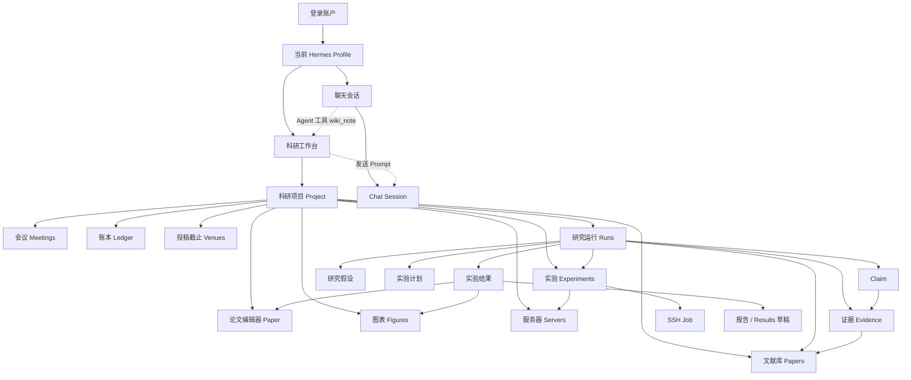
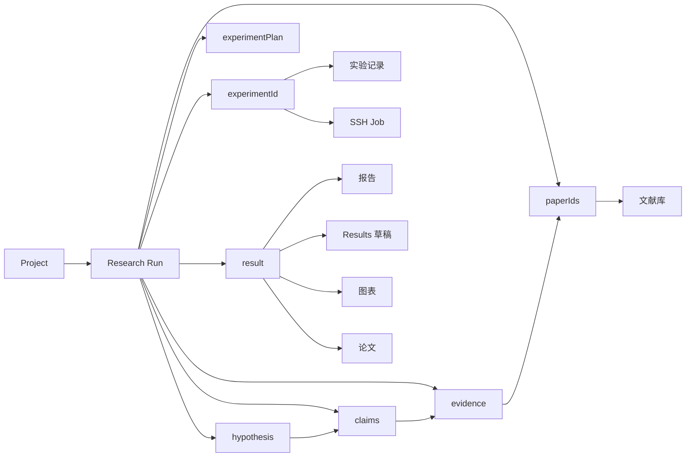

# 科研工作台、会话与模块关系

本文说明 MedHealthBuddy Studio 中“科研工作台”与聊天会话、账户、Profile、数据文件和 RBAC 的关系。

配套可视化图：

- [科研工作台模块关系](./research-workbench-modules.png)
- [研究运行自动化流程](./research-automation-flow.png)
- [图表说明文档](./research-workbench-diagrams.md)

相关代码入口：

```text
packages/client/src/views/hermes/MimirWorkbenchView.vue
packages/client/src/features/mimir/bridge.tsx
packages/client/src/features/mimir/ResearchPanel.tsx
packages/client/src/features/mimir/controller.ts
packages/client/src/stores/hermes/chat.ts
packages/server/src/modules/studio/services/research/
packages/server/src/modules/studio/controllers/research.ts
packages/server/src/modules/studio/controllers/research-runs.ts
packages/server/src/modules/studio/routes/research.ts
```

## 1. 一句话模型

科研工作台不是聊天会话的一部分，也不是一个独立数据库应用。

它是由当前账户、当前 Hermes Profile 承载的一套科研数据视图：

```text
账户
└── Hermes Profile（独立数据根目录）
    ├── 聊天会话（Chat Session）
    └── 科研工作台
        ├── 项目 Project
        ├── 文献 Papers
        ├── 实验 Experiments
        ├── 研究运行 Runs
        ├── 图表 Figures
        ├── 会议 Meetings
        ├── 服务器 Servers
        ├── 账本 Ledger
        └── 投稿截止 Venues
```

工作台可以“把问题发给当前聊天会话”，但聊天记录本身属于 Chat，不属于科研 state。

## 2. 整体关系图



## 3. 前端挂载关系

科研工作台是 Vue 页面中的一个 React 岛：

```text
MimirWorkbenchView.vue
└── createMimirWorkbench(host)
    ├── createResearchPanelStore()      面板 UI 状态
    ├── ResearchController             科研 remote 控制器
    ├── 注入回调                        发送到当前 Chat Session
    └── ResearchPanel                  上游科研工作台 React 组件
```

`bridge.tsx` 负责把上游 dsh 插槽所需的四类依赖拼出来：

```text
store         当前选中项目、活动 tab、全屏状态
controller    research state / 项目 / 文献 / 实验 / Run 操作
hooks         research、chrome、sessionList
t             zh/en 文案
```

### 3.1 工作台状态

`createResearchPanelStore()` 只保存查看状态，不保存科研业务数据：

```text
open
selectedProjectId
activeTab
paperFullscreen
```

业务数据来自服务端 `/api/studio/research/state`，不是 localStorage。

## 4. 十个页签与职责

工作台的 tab 顺序定义在 `features/mimir/shortcuts.ts`：

```text
overview
paper
papers
experiments
figures
meetings
servers
ledger
venues
runs
```

### 4.1 总览 `overview`

项目入口和聚合视图：

- 项目统计
- 最近动态
- 项目切换
- 快速进入其他 tab

### 4.2 论文 `paper`

LaTeX 论文编辑器：

- `main.tex` 编辑
- 编译 PDF
- 右侧 PDF 预览
- 图表插入
- 参考文献面板
- 项目文件路径

注意：`paper` 是“写论文”，`papers` 是“文献库”。

### 4.3 文献 `papers`

真实文献库：

- 文献导入、PDF、摘要
- 文件夹、标签、收藏
- arXiv / PubMed / Zotero
- PDF 阅读器
- 文献搜索
- 从文献生成 Related Work 提示词
- 发给当前聊天会话
- 测试数据默认不进入文献库

数据实体：

```text
ResearchPaper
ResearchFolder
```

### 4.4 实验 `experiments`

实验记录与实验日志：

```text
ResearchExperiment
ResearchJob
```

实验记录连接：

```text
项目
→ 实验
→ 服务器
→ SSH Job
→ 结果指标
```

它是“实验记录视图”，不是 Run 状态机视图。

### 4.5 图表 `figures`

项目和实验结果的可视化资产：

```text
ResearchFigure
```

来源包括：

- 手工上传
- 实验结果图表
- 指标对比图
- SVG/图片转换产物

图表可以插入论文。

### 4.6 会议 `meetings`

组会/汇报 deck 构建：

```text
ResearchDeck
```

数据来自项目、实验、图表和结果，不属于 Chat Session。

### 4.7 服务器 `servers`

远程实验服务器：

```text
ResearchServer
```

保存：

```text
host
user
port
projectId
```

SSH Job 从这里取连接信息。

### 4.8 账本 `ledger`

项目时间线与研究记录：

```text
ResearchJournalEntry
ResearchIdea
ResearchSnapshot
```

用于记录研究过程，不是财务账本。

### 4.9 投稿截止 `venues`

会议/期刊截止日期：

```text
ResearchVenue
ccfddl.json
```

提供投稿时间提醒，不参与 Run 状态机。

### 4.10 研究运行 `runs`

研究运行是把科研数据串起来的状态机：

```text
scope
literature
evidence
hypothesis
experiment
analysis
```

Run 不是论文、实验或会话的替代品，而是它们之间的编排记录。

## 5. 研究运行的数据关联



关键字段：

| 字段 | 含义 |
|---|---|
| `projectId` | 所属项目 |
| `paperIds` | 纳入文献 |
| `evidence[]` | 原文引用、页码、支持/矛盾关系 |
| `claims[]` | 从证据归纳出的 Claim |
| `hypothesis` | 研究假设 |
| `experimentPlan` | 数据集、基线、指标、命令、资源 |
| `experimentId` | 关联实验记录 |
| `experimentJobId` | 关联 SSH Job |
| `result` | 实验结果与指标 |
| `branches[]` | 分支实验 |
| `artifacts[]` | 远端产物 |
| `approvals[]` | 已通过的审批 |
| `approvalRequest` | 当前待审批请求 |
| `automation` | 后台自动编排配置 |

## 6. Run 生命周期

### 6.1 正常阶段

```text
scope
→ literature
→ evidence
→ hypothesis
→ experiment
→ analysis
```

### 6.2 人工门禁

Run 可以在以下位置暂停：

```text
证据表
Claim
实验执行
实验结果
最终报告
```

审批通过后，自动流程继续。

### 6.3 自动流程

点击“自动完成到结果门禁”后：

```text
文献为空
→ 自动检索 arXiv
→ 导入前 3 篇
→ 下载 PDF

有文献
→ 抽取证据
→ 生成 Claim
→ 生成假设与计划
→ 创建实验记录
→ 等待命令/服务器
→ 审批实验执行
→ 提交 SSH Job
→ 后台等待结果
→ 结果审批
→ 生成报告和 Results 草稿
→ 最终报告审批
→ 完成
```

后台编排器：

```text
run-orchestrator.ts
```

每 20 秒扫描 `automation.enabled = true` 的 Run，支持进程重启后继续。

自动化不会处理：

- 已完成的 Run
- 已取消的 Run
- 正在等待审批的 Run
- 未开启 automation 的手动 Run

## 7. 科研工作台与聊天会话的关系

### 7.1 它们是并列关系

```text
Profile
├── Chat Session
│   ├── messages
│   ├── tool calls
│   └── attachments
└── Research Workbench
    ├── project
    ├── papers
    ├── experiments
    ├── runs
    └── ...
```

聊天消息不写入 `research/state.json`。

科研项目、论文、实验和 Run 也不写入 Chat Session 的 messages。

### 7.2 工作台如何向会话发消息

桥接层提供：

```text
requestProjectSession(prompt)
requestProjectImage(image, prompt)
requestFigureOrganize(prompt)
requestVenueFormat(prompt)
```

执行路径：

```text
ResearchPanel
→ bridge.sendPromptToCurrentSession
→ useChatStore()
→ 确认当前 session 已加载
→ switchSession(sessionId)
→ chat.sendMessage(prompt)
```

所以工作台发送的 Prompt 会进入**当前选中的聊天会话**。

如果没有会话：

```text
toast.fixNoSession
```

不会静默创建新会话。

### 7.3 会话如何回到工作台

工作台阅读器保存：

```text
sessionSnapshot.current
sessionTitle
projectSession
```

并提供：

```text
openSession
prepareSession
```

聊天页的“回到工作台/阅读器”依赖这层快照和跳转回调。

### 7.4 Agent 如何写回科研数据

Agent 通过 `wiki_note` 工具读写科研数据：

```text
阅读全文
搜索文献
导出引用
写入研究记录
更新科研实体
```

它仍然受当前 Profile 和科研数据文件约束，不通过 Chat Session 直接持有科研数据库句柄。

## 8. 账户、Profile 与权限

### 8.1 账户

账户来自 Studio SQLite 用户表，负责：

```text
登录
角色
模块访问
可访问 Profile
```

### 8.2 Profile

Profile 决定数据目录：

```text
<profile home>/.research
```

不同 Profile 的科研数据和聊天会话相互隔离。

当前路径示例：

```text
E:\MedHealthBuddy\data\hermes\.research
```

### 8.3 模块权限

科研工作台对应模块：

```text
module.research:view
```

没有科研模块权限时：

- 侧栏不显示科研入口
- 路由守卫拦截
- 直接访问被重定向

### 8.4 操作权限

RBAC 已预留科研细粒度权限，例如：

```text
research.run:create
research.run:execute
research.run:approve
research.evidence:approve
research.paper:view
research.paper:edit
```

当前实际强制最明确的是：

```text
research.run:approve
```

用于审批 Run。

模块权限和操作权限不能替代 Profile 隔离：

```text
账户权限 ≠ 数据目录权限
Profile 访问      ≠ 模块访问
```

## 9. 数据存储

### 9.1 科研 state

```text
<profile home>/.research/state.json
<profile home>/.research/events.jsonl
```

`state.json` 保存：

```text
projects
papers
folders
experiments
figures
ideas
servers
jobs
venues
subscriptions
snapshots
decks
journal
runs
flows
```

### 9.2 项目文件

```text
<profile home>/.research/projects/<projectId>/
├── main.tex
├── main.pdf
├── references/
├── figures/
├── artifacts/
└── ...
```

### 9.3 会话数据

Chat Session 使用独立的会话存储，不属于 `.research/state.json`。

因此：

```text
删除科研项目 ≠ 删除聊天会话
删除聊天会话 ≠ 删除科研数据
切换聊天会话 ≠ 切换科研项目
```

## 10. API 关系

科研主入口：

```text
GET  /api/studio/research/state
GET  /api/studio/research/events
```

项目与条目：

```text
POST /api/studio/research/projects
POST /api/studio/research/items/:collection
PATCH /api/studio/research/items/:collection/:id
DELETE /api/studio/research/items/:collection/:id
```

研究运行：

```text
GET  /api/studio/research/runs
POST /api/studio/research/runs
GET  /api/studio/research/runs/:id
POST /api/studio/research/runs/:id/auto
POST /api/studio/research/runs/:id/advance
POST /api/studio/research/runs/:id/evidence
POST /api/studio/research/runs/:id/claims/derive
PATCH /api/studio/research/runs/:id/claims/:claimId
POST /api/studio/research/runs/:id/hypothesis
POST /api/studio/research/runs/:id/experiment-plan
POST /api/studio/research/runs/:id/create-experiment
POST /api/studio/research/runs/:id/submit-experiment
POST /api/studio/research/runs/:id/refresh-experiment
POST /api/studio/research/runs/:id/approvals/:approvalId/resolve
```

文献与论文：

```text
GET  /api/studio/research/arxiv/search
POST /api/studio/research/projects/:id/papers/import-arxiv
GET  /api/studio/research/projects/:id/paper
PUT  /api/studio/research/projects/:id/paper
POST /api/studio/research/projects/:id/compile
```

## 11. 当前边界

### 已具备

- 科研项目、文献、实验、图表、会议、服务器、账本、投稿截止、研究运行
- Run 与文献/证据/Claim/假设/实验/结果关联
- 自动抽取证据、生成 Claim、计划、实验记录
- 人工审批门禁和审批后自动恢复
- 后台 Run 编排器
- 异步 SSH Job 轮询
- 自动 arXiv 检索和选文
- 最终报告审批
- fixture 按账户隔离且不进入真实文献库
- 工作台向当前 Chat Session 发送 Prompt
- Agent 通过 `wiki_note` 读写科研数据

### 仍需注意

- 工作台与 Chat 仍是两个独立状态域，没有“一个会话对应一个科研项目”的强绑定
- 工作台发送 Prompt 依赖当前已选中的 Chat Session
- 科研 state 以 Profile 为隔离边界，不是天然按账户隔离
- fixture 是例外，额外记录 `fixtureOwnerUserId`
- 长任务依赖后台编排器轮询，不是独立任务队列服务
- 审批通知仅在 Run 页面内展示，不发送邮件/飞书/移动端
- 风险阈值和命令白名单固定为代码策略，没有配置界面

## 12. 结论

```text
科研工作台 = Profile 级科研数据与操作界面
聊天会话   = Profile 级 Agent 对话历史
项目       = 科研数据聚合根
Run        = 项目内研究与实验的编排状态机
实验       = Run 的执行记录和服务器 Job
论文       = 项目文件的 LaTeX 编辑与编译视图
```

工作台和会话通过 Prompt/工具调用协作，但数据归属分开：

```text
Prompt 进入 Chat
科研数据写入 Research state
两者共享 Profile 隔离边界
```
